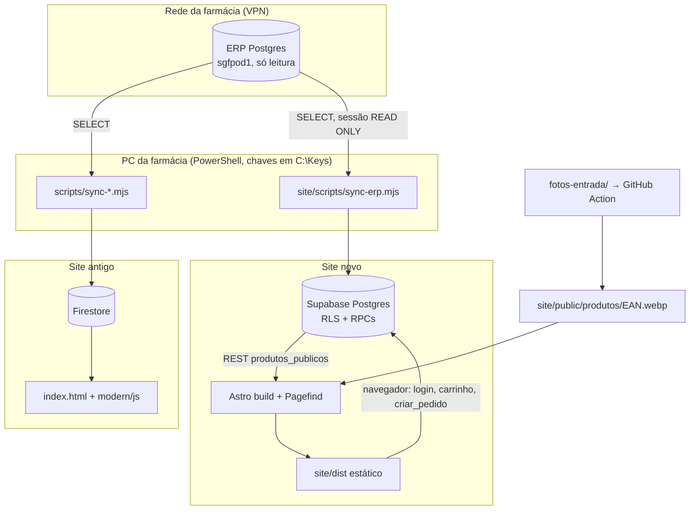
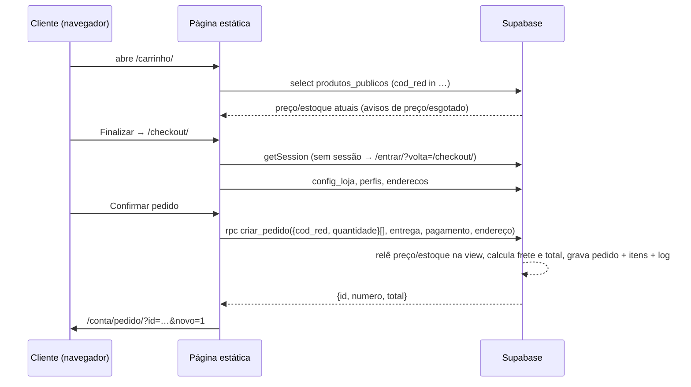

# Mapa do código: Farmácia São Benedito

> Gerado pelo Cartographer. Último mapeamento: 2026-11-14T17:46:58Z.
> Ficaram de fora: `data/products.json` (3 MB de dados), as pastas geradas (`site/dist`, `site/.astro`, `node_modules`) e `site/scripts/.saida/`, que é privada e tem credenciais e dados do ERP.

O repositório tem **dois sites** e **dois pipelines de dados** convivendo enquanto a migração não termina:

| | Site antigo (no ar) | Site novo (em construção) |
|---|---|---|
| Pasta | raiz (`*.html`, `modern/`, `sw.js`) | `site/` |
| Tecnologia | HTML + ES modules sem build, Firebase 9.6 via CDN | Astro 7 (estático) + Supabase + Pagefind |
| Banco | Firestore (`produtos`, `catalogo/parte-N`, `pedidos`…) | Supabase Postgres, região São Paulo (`produtos`, `pedidos`…) |
| Sync do ERP | `scripts/*.mjs` (firebase-admin) | `site/scripts/sync-erp.mjs` (pg) |
| Total do pedido | calculado no navegador (inseguro) | calculado no banco (`criar_pedido`) |
| Hospedagem | GitHub Pages, branch `main` na raiz | ainda sem deploy (build local; fase 6) |

## Visão geral



## Estrutura de pastas

```
/                         site antigo (GitHub Pages serve a raiz)
├── index.html, produtos.html, checkout.html, conta.html, pedidos.html,
│   privacidade.html, termos.html, instrucoes.html, modern-admin.html
├── modern-index.html     só redireciona para ./
├── sw.js                 service worker (CACHE_NAME = farmacia-shell-vN)
├── manifest.webmanifest
├── firestore.rules, firebase.json
├── modern/
│   ├── components/       header/footer/modals/bottom-nav injetados via ComponentLoader
│   ├── css/              modern-styles.css (tokens) + CSS por página
│   └── js/               bootstrap, páginas e services/ (firebase, cart, auth, modals…)
├── scripts/              pipeline antigo ERP → Firestore (+ SQL de auditoria do ERP)
├── config/product-filters.json   regras de bloqueio (usadas pelos DOIS pipelines)
├── data/products.json    exportação antiga (vitrine e dados de exemplo do site novo)
├── tests/firestore-rules/  testes das regras do Firestore (emulador)
├── docs/                 SEGURANCA-FIRESTORE.md, este mapa
├── fotos-entrada/        fotos do celular para processar (gatilho do Action)
├── .github/workflows/fotos-produtos.yml
├── .claude/              launch.json (previews "site" e "site-novo"), skill fotos-produtos
└── site/                 SITE NOVO
    ├── astro.config.mjs  SITE_URL / BASE_PATH por variável de ambiente
    ├── .env              só PUBLIC_SUPABASE_URL e PUBLIC_SUPABASE_ANON_KEY (fora do Git)
    ├── public/           img/, produtos/<EAN>.webp
    ├── src/
    │   ├── data/loja.ts  dados da loja (RDC 44); campos PREENCHER
    │   ├── lib/          catalogo.ts (build), secoes.ts, supabase.ts, url.ts
    │   ├── layouts/Base.astro
    │   ├── components/   Catalogo (submenu), Listagem, ProdutoCard, ProdutoImagem
    │   ├── pages/        rotas (ver tabela abaixo)
    │   ├── scripts/      código do navegador: carrinho, sessão, endereços, busca…
    │   └── styles/       global.css (tokens/formulários), produto-card.css
    ├── scripts/          sync-erp, aplicar-migrations, erp-investigar, fotos-produtos
    └── supabase/
        ├── migrations/   0001 schema · 0002 RLS · 0003 RPCs · 0004 service_role · 0005
        └── tests/        db.test.mjs, sync.test.mjs (PGlite, sem Docker)
```

---

## Site novo (`site/`)

### Build × navegador
- **No build** (frontmatter, `getStaticPaths`, `lib/catalogo.ts`) roda Node e gera as páginas a partir do catálogo.
- **No navegador** (`<script>` e `src/scripts/*`) rodam carrinho, login, checkout, conta, pedidos, busca e a atualização "ao vivo" de preço e estoque, falando direto com o Supabase. O RLS e as RPCs garantem a segurança.
- O HTML do produto é uma foto do último build. `ao-vivo.ts` e `carrinho-revalidar.ts` corrigem preço e estoque no navegador.

### lib/
| Arquivo | Papel |
|---|---|
| `catalogo.ts` | **Só build.** `carregarProdutos()` (memoizado). Lê `produtos_publicos` via REST, só com o header `apikey`, porque a chave `sb_publishable_` não é JWT. Pagina com `Range` de 1000 em 1000. Sem `.env`, usa `../data/products.json` com os filtros de `config/product-filters.json`. `ligarFotos` liga `public/produtos/<EAN>.webp` pelo EAN. Também tem `destaquesHome` (só MIP), `temDesconto` e `percentualDesconto`. |
| `secoes.ts` | Sem dependência de Node, serve também ao navegador. `SECOES` (slug, nome, categorias, cor), `MENU_SECAO` (nome curto e ícone SVG), `NOME_TIPO`, `NOME_CATEGORIA`, `secaoDaCategoria`, `brl`, `dividirNome`. |
| `supabase.ts` | Cliente (PKCE, sessão persistida), ou `null` sem `.env`. |
| `url.ts` | `u(path)` respeita o `BASE_PATH`; também `urlProduto` e `urlSecao(slug, n)`. |

### Rotas
| Rota | Arquivo | Observação |
|---|---|---|
| `/` | `index.astro` | Hero, seções (só no celular), 8 ofertas, JSON-LD `Pharmacy` |
| `/categoria/<secao>/[n]/` | `categoria/[secao]/[...pagina].astro` | 48 por página, atalhos de tipo |
| `/tipo/<tipo>/[n]/` | `tipo/[tipo]/[...pagina].astro` | genéricos, referência, similares, outros |
| `/ofertas/[n]/` | `ofertas/[...pagina].astro` | com desconto, maior % primeiro |
| `/produto/<slug>-<cod>/` | `produto/[slug].astro` | JSON-LD Product, "mesmo princípio ativo", metadados do Pagefind |
| `/busca/?q=&secao=` | `busca.astro` | Pagefind JS API, mesma grade de cards |
| `/carrinho/`, `/checkout/` | | noindex |
| `/entrar/`, `/redefinir-senha/` | | login, cadastro, esqueci a senha |
| `/conta/`, `/conta/pedidos/`, `/conta/pedido/?id=` | | exigem login; LGPD (baixar e excluir) |
| `/sobre/`, `/privacidade/`, `/termos/`, `/404` | | |

### Componentes e layout
- **`Base.astro`**:
  - cabeçalho com faixa, logo, busca (GET `/busca/`), conta e carrinho, e menu de seções com ícones (nomes curtos abaixo de 1000px; 4 colunas no celular);
  - rodapé com os dados legais;
  - script global com cliques delegados em `[data-qtd-passo]` e `[data-add-carrinho]`, o contador do carrinho e o rótulo Entrar/Conta, que olha a chave `sb-*-auth-token` sem carregar o Supabase.
- **`Catalogo.astro`**: a partir de 1000px, grade de 5 colunas: submenu (1 card de largura, 4 seções e o botão "Fale com nossa equipe") + conteúdo (4 cards por linha).
- **`Listagem.astro`**: migalhas, h1, atalhos de tipo, grade e paginação.
- **`ProdutoCard.astro` / `ProdutoImagem.astro`**: card com preço cheio riscado, % e preço final, quantidade −/+ e Adicionar. Sem foto, mostra um card tipográfico na cor da seção.

### Carrinho, sessão e pedido (navegador)
- **`scripts/carrinho.ts`**:
  - guarda no localStorage `sb_carrinho_v1` um array de `ItemCarrinho` (cod_red, slug, nome, preco, estoque, tipo_venda, quantidade, selecionado, preco_anterior?, indisponivel?);
  - cada gravação dispara o evento `carrinho:mudou`;
  - `itensDoPedido()` devolve os itens marcados e disponíveis; `removerItens()` tira só os comprados.
- **`scripts/carrinho-revalidar.ts`**: `revalidar()` consulta `produtos_publicos`. Fica separado para não carregar o supabase-js em todas as páginas.
- **`scripts/sessao.ts`**:
  - `cliente()`, `usuarioAtual()`;
  - `exigirLogin()`, que redireciona para `/entrar/?volta=`;
  - `destinoVolta()`, que só aceita caminhos internos;
  - `mensagemErro()` (erros do Supabase e do banco em português), `esc()`, rótulos de status, pagamento e entrega;
  - `VERSAO_POLITICA`.
- **`scripts/enderecos.ts`**: CRUD de `enderecos` (via RLS), o formulário compartilhado entre conta e checkout, e o ViaCEP (envia só o CEP).
- **Checkout**:
  1. `exigirLogin`, depois `revalidar`;
  2. carrega `config_loja`, `perfis` e endereços;
  3. o cliente escolhe entrega e pagamento (por ora só "na entrega");
  4. `rpc('criar_pedido')` grava o pedido;
  5. `removerItens` tira os comprados do carrinho;
  6. redireciona para `/conta/pedido/?id=…&novo=1`.



### Busca (Pagefind)
- Só o `<article data-pagefind-body>` das páginas de produto é indexado. Ele carrega spans escondidos com `meta=title`, `meta=produto` (JSON para o card), `filter=secao` e `sort=preco`.
- O índice nasce no `npm run build` (`astro build && pagefind --site dist`), então **não existe no `npm run dev`**.
- `busca.astro` faz `import()` do `pagefind.js` e chama `filters()` antes de `search()`; sem isso, a contagem por seção volta vazia. Os resultados saem em lotes de 24, com `cardHtml()`.

---

## Banco do site novo (`site/supabase/migrations/`)

| Migration | Conteúdo |
|---|---|
| `0001_schema.sql` | Tabelas `produtos` (colunas do ERP + editoriais), view `produtos_publicos`, `config_loja` (1 linha: frete, parcelas, versão da política), `admins`, `perfis`, `enderecos`, `pedidos` (número a partir de 1001), `pedido_itens`, `pedido_status_log`, `pagamentos_eventos`. Gatilhos `tg_novo_usuario` (cria o perfil com o aceite) e `tg_log_status`. |
| `0002_rls.sql` | RLS em tudo. Revoga o padrão do Supabase e devolve só o necessário. Anônimo lê `produtos_publicos` e `config_loja`; cliente acessa os próprios perfis, endereços e pedidos (pedidos só leitura); equipe (`is_equipe`/`is_admin`) vê tudo. |
| `0003_rpc.sql` | `criar_pedido` (total no servidor), `cancelar_meu_pedido`, `admin_mudar_status` (transições válidas), `admin_atualizar_produto` (só campos editoriais), `exportar_meus_dados`, `excluir_minha_conta` (anonimiza os pedidos). EXECUTE só para `authenticated`. |
| `0004_service_role.sql` | Permissões do `service_role`: o projeto foi criado com "expose new tables" desligado. |
| `0005_pedido_sem_declaracao.sql` | `criar_pedido` sem exigir declaração de receita (decisão da farmácia). O pedido continua marcado com `tem_prescricao`. |

- **`produtos_publicos`**: `publicado AND (NOT pendente OR liberado_manual) AND estoque > 0`. `destaque` só vale para MIP (RDC 96/2008), e `tipo_venda` = `coalesce(tipo_venda_manual, tipo_venda)`.
- **Status do pedido**: `aguardando_pagamento` → `pago` → `separando` → `enviado` ou `pronto_retirada` → `entregue`, com `cancelado` a partir de qualquer passo. Na tela, um pedido "na entrega" ainda não pago aparece como **Recebido**.
- As migrations são aplicadas por `site/scripts/aplicar-migrations.mjs`, que registra cada uma em `public._migrations` (com RLS e sem políticas).

---

## Pipelines ERP → site

### Regras comuns
- O ERP é lido em `cadprodu` + `cadestoq` (filial 3) + `cadcddcb` (DCB) + `cadlabor` + `cadcdbar` (EAN; este só no pipeline novo). Só entram produtos com `flg_ativo='A'`.
- **Exclusões regulatórias**:
  - `tip_classeterapeutica` preenchida (SNGPC 1 = antimicrobiano, 2 = controle especial) fica fora nos dois pipelines;
  - o pipeline novo exclui também `tip_lista` preenchida (listas A1–C5 da Portaria 344 e `T`, antimicrobiano).
- **`calcularPreco`**: um desconto maior que 1 é lido como porcentagem; entre 0 e 1, como fração.
- **Categorias** por `cod_grupo`: 10000 suplementos, 9000 hospitalares, 4000 genéricos, 8000 dermocosméticos (com `nom_prodcomp` como nome), 3000 referência, 2000 similares; o resto vira `medicamentos`.
- **`config/product-filters.json`**: palavras proibidas, preço mínimo, desconto máximo, regex e allowlist. Um produto que bate nessas regras fica `pendente`; não é apagado.
- O ERP **não tem campo de tarja**: `tip_id_tarja` está vazio. Os medicamentos ficam `prescricao` por padrão, e o admin corrige com `tipo_venda_manual`.

### Pipeline novo: `site/scripts/sync-erp.mjs`
- Runner: `.\site\scripts\run-sync-erp.ps1 [-Modo completo|estoque] [-DryRun]`, executado da raiz do projeto e com VPN.
- Lê o ERP numa sessão `READ ONLY` e grava no Supabase numa única transação; o `DRY_RUN` faz ROLLBACK no fim.
- **`lib/produtos-erp.mjs`**: transformação pura (preço, categoria, slug, bloqueio, EAN).
- **`lib/gravar-supabase.mjs`**:
  - upsert com `ON CONFLICT … WHERE (…) IS DISTINCT FROM (…)`, então só grava o que mudou e nunca toca nos campos editoriais;
  - zera o estoque de produtos que saíram do ERP, exceto em amostra.
- Dispara `repository_dispatch` (`catalogo-atualizado`) se houver `GITHUB_TOKEN`. **Ainda não há workflow que escute esse evento.**
- `erp-investigar.mjs` é o "passo 0": descobre colunas do ERP e grava o resultado em `.saida/`.

### Pipeline antigo: `scripts/` (Firestore)
- **`sync-pg-to-firestore.mjs`** (completo) e **`sync-stock-only.mjs`** (estoque) comparam com o estado local `scripts/.state/produtos-sync.json` e gravam só o que mudou.
- **`build-catalog.mjs`** gera e atualiza de forma incremental o catálogo agregado `catalogo/parte-N` + `meta/counters`.
- Outros:
  - `clean-products.mjs` desativa ou apaga produtos com estoque ≤ 0;
  - `export-pg-to-json.mjs` gera `data/products.json`;
  - `verify-stock.mjs` compara o ERP com o Firestore numa amostra;
  - `set-admin-claim.mjs` e `process-admin-requests.mjs` cuidam das permissões de admin no Firebase;
  - os SQL de auditoria e permissão do ERP (`grant-*`, `enable-maintenance-*`).
- A cota grátis do Firestore é de 50 mil leituras e 20 mil gravações por dia. Detalhes em `scripts/README.md`.

### Fotos de produtos
1. Fotografar no celular duas fotos por produto, em sequência: o produto e depois o código de barras.
2. Enviar para `fotos-entrada/`.
3. `.github/workflows/fotos-produtos.yml` roda `site/scripts/fotos-produtos.mjs`:
   - ordena as fotos pelo EXIF;
   - lê o EAN (zxing-wasm);
   - remove o fundo com @imgly (AGPL: usar só como ferramenta interna);
   - gera um quadrado de 800px em WebP;
   - grava `site/public/produtos/<EAN>.webp`.
4. Fotos sem par vão para `fotos-entrada/revisar/` com o motivo registrado em `LEIA-ME.txt`.
5. No build, `ligarFotos` associa a foto pelo EAN. Uma foto cadastrada no admin tem prioridade.
- A skill `.claude/skills/fotos-produtos` orienta como diagnosticar quando uma foto não aparece.

---

## Site antigo (raiz + `modern/`)

- **Entradas**:

  | Página | Script |
  |---|---|
  | `index.html` | `app.js` |
  | `produtos.html` | `produtos-firebase.js` |
  | `checkout.html` | `checkout.js` |
  | `conta.html` | `account.js` |
  | `pedidos.html` | `orders.js` |
  | `instrucoes.html` | `instrucoes.js` |
  | `privacidade.html`, `termos.html` | `legal-page.js` |
  | `modern-admin.html` | `admin.js` |

- **Inicialização (`bootstrap.js`)**: uma única `init()` compartilhada, que inicia, nesta ordem:
  1. firebase (pode falhar e seguir em modo offline);
  2. carrinho;
  3. auth;
  4. modais.

  No fim expõe `window.cartService`, `window.authService` e `window.modalsManager`.
- **Catálogo (`firebase-service.js`)**, em ordem de tentativa:
  1. cache no IndexedDB com menos de 10 minutos;
  2. `meta/counters.catalogVersion`;
  3. as partes de `catalogo/parte-N`;
  4. a coleção `produtos` inteira (cerca de 10 mil leituras);
  5. o cache vencido, ou `data/products.json`.
- **Carrinho** em `modern_pharmacy_cart`. **Pedido** via `createOrder`, que usa uma transação no `orderSeq`.
- **Tokens de CSS**: `modern-styles.css` (`--primary-color #1e40af`, Inter). Os componentes são HTML injetados pelo `ComponentLoader`, com cache `component_cache_v4_*` de 6 horas.

---

## Convenções
- Código, comentários, mensagens e documentação em **português**.
- Segredos **nunca** no repositório:
  - chaves em `C:\Keys\` (Firebase admin, `supabase-db-url.txt`, CA, token do GitHub);
  - senha do ERP pedida pelo `Read-Host` ou lida de `$env:PGPASSWORD`;
  - no `site/.env`, só valores públicos.
- Os runners `.ps1` rodam **da raiz do projeto**: `powershell -ExecutionPolicy Bypass -File .\site\scripts\…`. Não são scripts do `npm run`.
- Site novo:
  - todo `innerHTML` passa por `esc()`;
  - erros do banco são códigos (`raise exception 'codigo:…'`), traduzidos por `mensagemErro()`;
  - o preço vindo do navegador nunca é confiado.
- Um card de produto existe em **dois lugares**: `ProdutoCard.astro` e `scripts/card-html.ts`. Mudou um, mude o outro.
- Testes:
  - `cd site && npm run test:db` cobre banco, RLS e sync, num Postgres em memória (PGlite);
  - `tests/firestore-rules` cobre o site antigo e precisa de Java e do emulador.

## Armadilhas
- **`getStaticPaths` é isolado** do resto do arquivo: constantes como `POR_PAGINA` precisam ficar dentro dele.
- **O build do site novo precisa rodar dentro de `site/`**: o modo de exemplo lê `../data/products.json` a partir do `process.cwd()`.
- **A busca não funciona no `npm run dev`**: use `npm run build && npm run preview`.
- **Classes com `display` anulavam `hidden`**: o `global.css` tem `[hidden]{display:none!important}`.
- **No site antigo, mudou JS ou CSS, aumente `CACHE_NAME` em `sw.js`.** O service worker serve arquivos do mesmo domínio primeiro do cache e não revalida. Para HTML de componente, aumente também `version` no `ComponentLoader`.
- **Problemas conhecidos do site antigo** (a migração resolve):
  - total do pedido calculado no navegador;
  - cupons fixos no JS;
  - quando o `createOrder` falha, a tela de sucesso aparece mesmo assim;
  - o admin grava `name/price/stock` enquanto a loja lê `nome/precoComDesconto/quantidade`;
  - o pipeline antigo não filtra `tip_lista`;
  - `instrucoes.html` é público e sem `noindex`.
- **`VERSAO_POLITICA` aparece em 4 lugares**: `sessao.ts`, `privacidade.astro`, `termos.astro` e `config_loja.politica_versao`.
- **Supabase Auth**:
  - o envio padrão de e-mail só chega a membros do projeto, então clientes reais precisam de SMTP próprio;
  - configure as Redirect URLs e a senha mínima de 8 caracteres.
- **O `repository_dispatch` do sync ainda não tem workflow** que gere e publique o site.

## Guia rápido
| Tarefa | Onde mexer |
|---|---|
| Mudar dados da loja ou rodapé legal | `site/src/data/loja.ts` (o texto fixo de cidades fica em `Base.astro` e `index.astro`) |
| Mudar seções ou menu | `site/src/lib/secoes.ts` (as rotas, o submenu e o filtro de busca derivam dele) |
| Mudar o card de produto | `ProdutoCard.astro` + `scripts/card-html.ts` + `ProdutoImagem.astro` + `styles/produto-card.css`; dado novo também em `metaBusca` (produto) |
| Nova página pública | `src/pages/x.astro` com `<Base>`; link no rodapé de `Base.astro` |
| Nova página com login | Copiar o padrão de `conta.astro`: `exigirLogin()` + `noindex` |
| Nova regra de pedido ou erro do banco | Nova migration `000N_*.sql` (+ teste em `db.test.mjs`) e uma linha em `mensagemErro()` |
| Aplicar migrations | `.\site\scripts\run-aplicar-migrations.ps1` |
| Sincronizar o ERP | `.\site\scripts\run-sync-erp.ps1 [-Modo estoque] [-DryRun]` (com VPN) |
| Regras de bloqueio de produto | `config/product-filters.json` (vale para os dois pipelines) |
| Fotos | Enviar para `fotos-entrada/` (Action) ou rodar `node scripts/fotos-produtos.mjs` dentro de `site/` |
| Ver o site novo | `cd site && npm run build && npm run preview` (ou a configuração "site-novo" em `.claude/launch.json`) |
